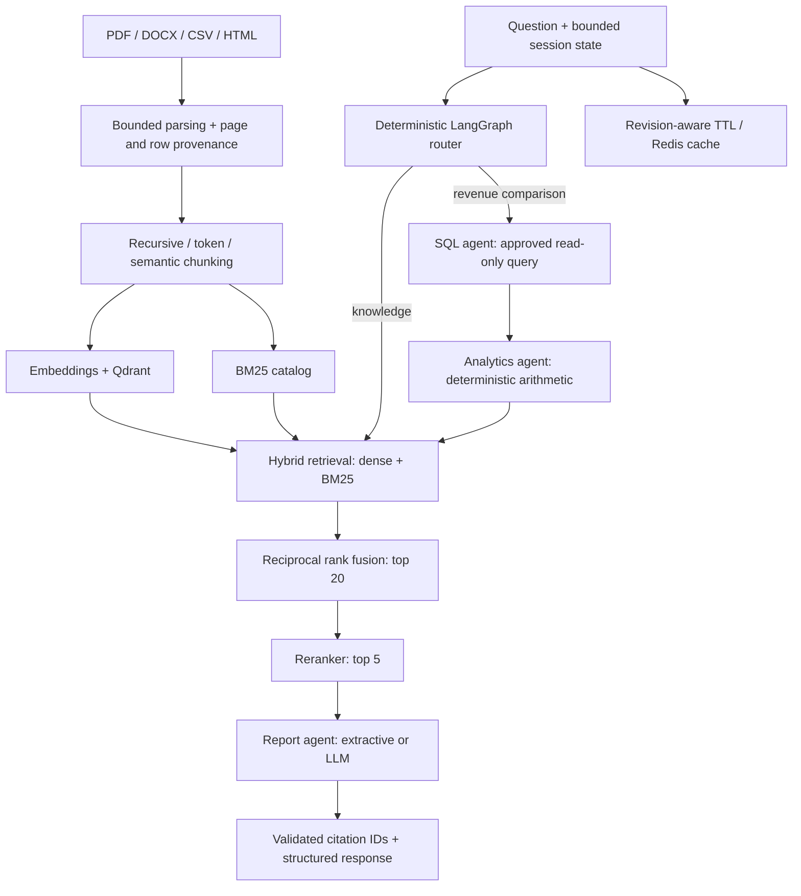

# Enterprise Knowledge Intelligence Assistant

An evidence-first enterprise document assistant with **hybrid RAG, four deterministic LangGraph agents, source citations and a browser interface**. It answers questions over PDFs, Word files, CSVs and web documents, and combines approved SQL queries with document evidence for quarterly revenue analysis.

**Independent portfolio project. All included business documents and revenue figures are synthetic.** This is a working, single-workspace reference implementation with deployment scaffolding, not a claim of production certification.

## Try the project

Requires Python 3.11+. From this repository folder:

```bash
python -m venv .venv
# Windows PowerShell:
.venv/Scripts/Activate.ps1
# macOS/Linux instead: source .venv/bin/activate
pip install -e ".[dev]"
python -m eki.cli ingest data/demo
python -m uvicorn eki.api:app --host 127.0.0.1 --port 8000
```

Open **http://127.0.0.1:8000**. Enter the local demo API key `local-demo-change-me` and click **Connect**. This is a deliberately public local-development value; set a strong `EKI_API_KEY` for any shared environment. The key stays in the current page, not localStorage.

Try:

- “Analyze Q2 revenue and explain why it decreased compared with Q1.”
- “What is the remote work policy?”
- “How quickly must a security incident be reported?”

The revenue example calculates **1,200,000 → 960,000, a decrease of 240,000 (20%)**, and cites the CSV rows plus the separate management commentary. It distinguishes reported explanations from proven causes.

The default runs without paid APIs: **hash-vector baseline + BM25 + lexical reranking + extractive answers**. It really uses Qdrant and LangGraph, but hash vectors are not learned semantic embeddings and extractive responses are not LLM generation. The tokenizer downloads its vocabulary on first use.

## Enable learned retrieval and LLM generation

```bash
pip install -e ".[neural,observability]"
```

Copy `.env.example` to `.env` and set:

```dotenv
EKI_EMBEDDING=fastembed
EKI_RERANKER=fastembed
EKI_DATA_DIR=data/runtime/neural
```

Stop the server, ingest again into that fresh data directory, and restart it. FastEmbed downloads `BAAI/bge-small-en-v1.5` and the `Xenova/ms-marco-MiniLM-L-6-v2` cross-encoder on first use. Learned embeddings, learned reranking and semantic chunking were executed locally; see [evaluation results](eval/neural-results.json).

For optional LLM synthesis, also set `EKI_GENERATOR=openai`, `OPENAI_API_KEY` and `EKI_LLM_MODEL`. Only the selected evidence and question are sent to the provider. This adapter is implemented but was not tested against a paid live model. Without a key, keep `extractive` mode. Provider failures return an explicit error; they do not silently switch modes.

## Architecture



Qdrant is the selected vector database from the requested alternatives. SQLite stores the bounded chunk catalog and the read-only analytics dataset. PostgreSQL/pgvector is not also deployed: adding a second vector database would duplicate Qdrant's role. The SQL agent supports a deliberate approved comparison workflow, not arbitrary natural-language-to-SQL execution.

## Included capabilities

| Area | Implementation |
|---|---|
| Ingestion | PDF pages, DOCX paragraphs/tables, CSV rows, HTML, TXT and Markdown; allowlisted HTTPS loader |
| Chunking | Paragraph/sentence recursive packing, tokenizer windows, learned adjacent-unit similarity boundaries |
| Search | Qdrant dense retrieval + BM25, reciprocal rank fusion, top-20 candidates and top-5 reranking |
| Agents | Retriever, read-only SQL, deterministic analytics and report agents routed by LangGraph |
| Grounding | Per-claim evidence IDs, page/row provenance, evidence endpoint, abstention |
| Memory/cache | Last four user questions, session TTL, bounded local cache or Redis, corpus-revision invalidation |
| Protection | API-key access, query limits, upload limits, known-injection screening, no model tool execution, citation-ID validation |
| Observability | Prometheus metrics, JSON request traces, optional Langfuse metadata spans and model token usage |
| Delivery | FastAPI/OpenAPI, browser UI, non-root Docker image, Compose, CI and manual AWS workflow |

## Results and verification

- **60/60 authored regression cases passed** in both baseline and learned retrieval modes, using extractive generation.
- The dataset contains 40 knowledge questions, 5 revenue comparisons, 10 unanswerable questions and 5 malicious requests.
- Expected-source recall@5: **100%** on these 45 answerable cases. This tiny synthetic dataset is a regression fixture, not evidence of general enterprise accuracy.
- Unit/API/security tests cover parsing, provenance, chunk limits, duplicate/version handling, SQL arithmetic, cache invalidation, session isolation and blocked operations.
- [Baseline results](eval/results.json), [neural results](eval/neural-results.json), [cache benchmark](eval/cache-benchmark.json), [chunking experiment](eval/chunking-comparison.json).

The evaluation reports answer matching, citation validity and exact-quote support. These are explicitly labelled proxies; no RAGAS score or independently judged semantic faithfulness score is claimed. Read [evaluation methodology](docs/evaluation.md).

```bash
pytest -q
python scripts/evaluate.py
python scripts/evaluate.py --neural --output eval/neural-results.json
python scripts/benchmark_cache.py
python scripts/compare_chunking.py
```

## API

All data endpoints require `X-API-Key`. `/health`, `/` and OpenAPI documentation are public metadata/UI endpoints.

| Method | Endpoint | Purpose |
|---|---|---|
| POST | `/documents/upload` | Multipart file + optional `strategy` |
| POST | `/documents/web` | Allowlisted HTTPS HTML import |
| POST | `/chat` | Question and session ID → structured answer |
| POST | `/search` | Query and limit → ranked evidence |
| GET | `/evidence/{id}` | Original chunk text and provenance |
| GET | `/status` | Corpus and active modes |
| GET | `/health` | Application liveness |
| GET | `/metrics` | Prometheus request counts, errors and latency |

See http://127.0.0.1:8000/docs for interactive request schemas. Example:

```json
{"question":"Compare Q1 and Q2 revenue.","session_id":"demo-1"}
```

Responses contain `answer`, `claims`, `sources`, `tools_used`, `confidence`, `confidence_note`, `status`, `mode`, `cached`, `trace_id`, `latency_ms` and `usage`. Confidence is an evidence-coverage heuristic, not a calibrated probability that an answer is correct.

## Docker and AWS

```bash
# Copy .env.example to .env and set EKI_API_KEY first
docker compose up --build -d
```

Then upload demo files through the UI. Do not run the CLI concurrently against the embedded local Qdrant directory; for server mode, use API uploads as the single writer. Compose uses Qdrant and Redis on an internal network, persistent volumes, and binds the API only to localhost.

GitHub Actions runs tests, evaluation and a Docker build. The manual AWS workflow builds an ECR image and provisions a private-access EC2 demonstration using CloudFormation. **AWS was not deployed**; no AWS account or paid credentials were supplied. Docker is not installed on the build workstation, so container/service checks run in GitHub CI. See [deployment guide](docs/deployment.md) for access, costs, prerequisites and cleanup.

## Learn and present it

- [Project explained for interviews](docs/project-guide.md)
- [Architecture and design choices](docs/architecture.md)
- [Security boundaries and limitations](docs/security.md)
- [Runbook and observability](docs/runbook.md)
- [Validation record](docs/validation.md)

Before using real enterprise data, add organization identity/SSO and document ACLs, network egress enforcement, isolated parsing workers, backups, workload testing and independent grounding evaluations. This repository implements one shared workspace; it must not be represented as a multi-tenant production system.
